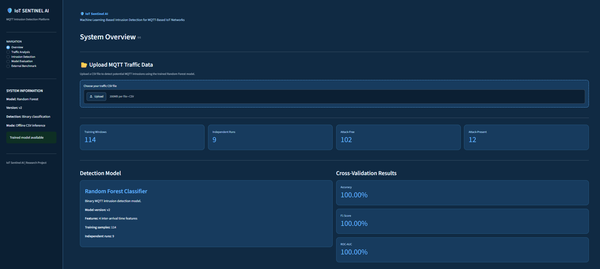
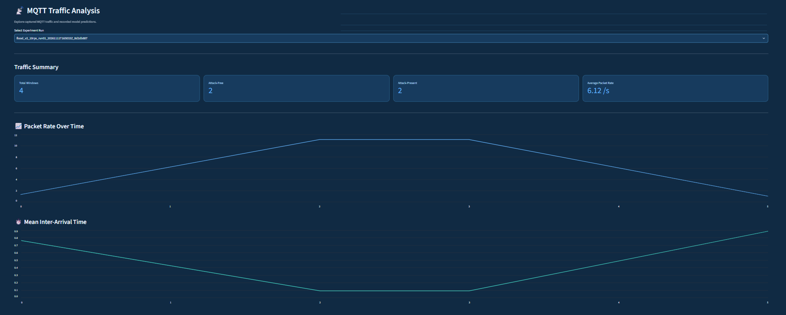
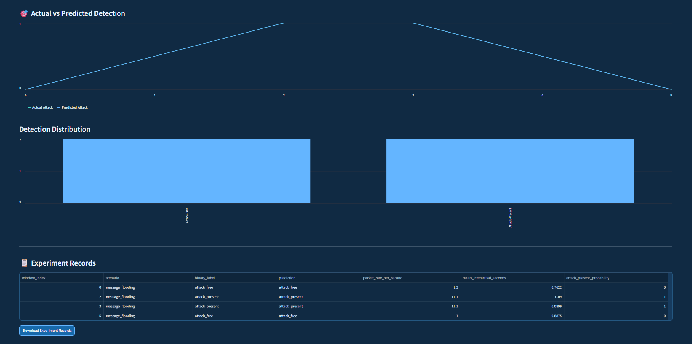
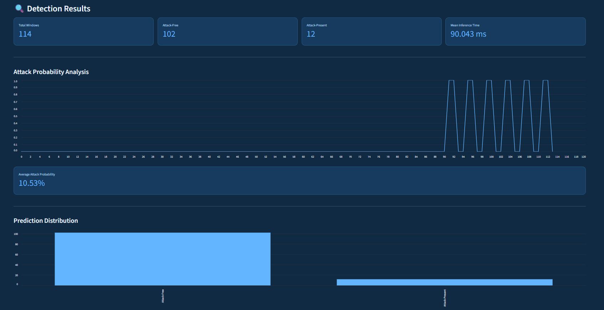
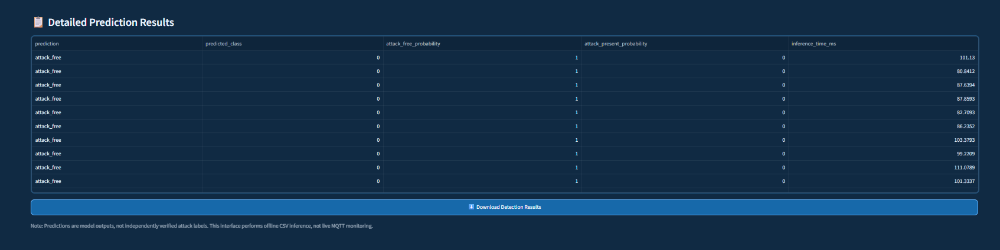
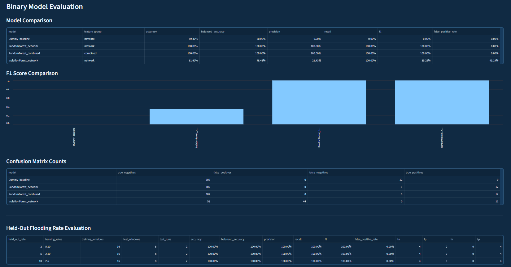
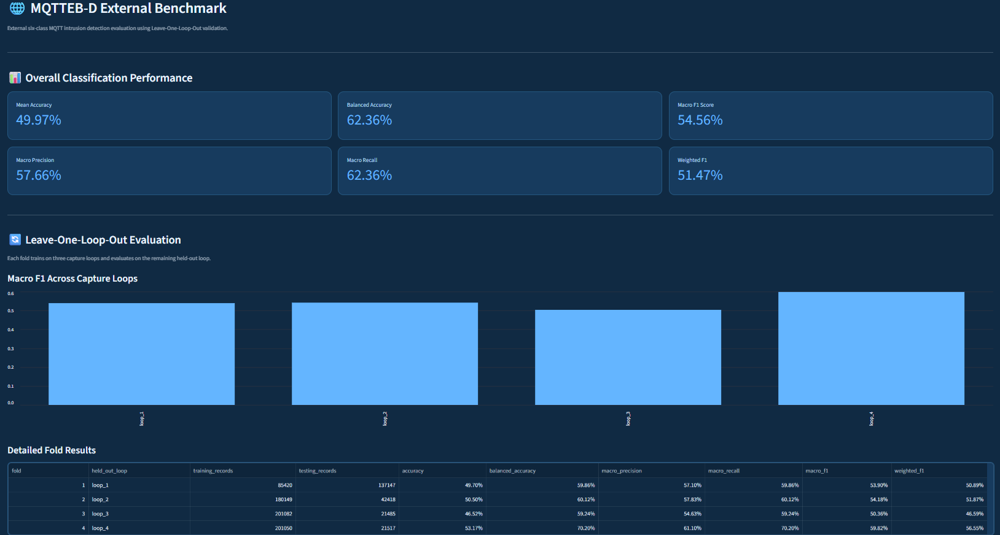
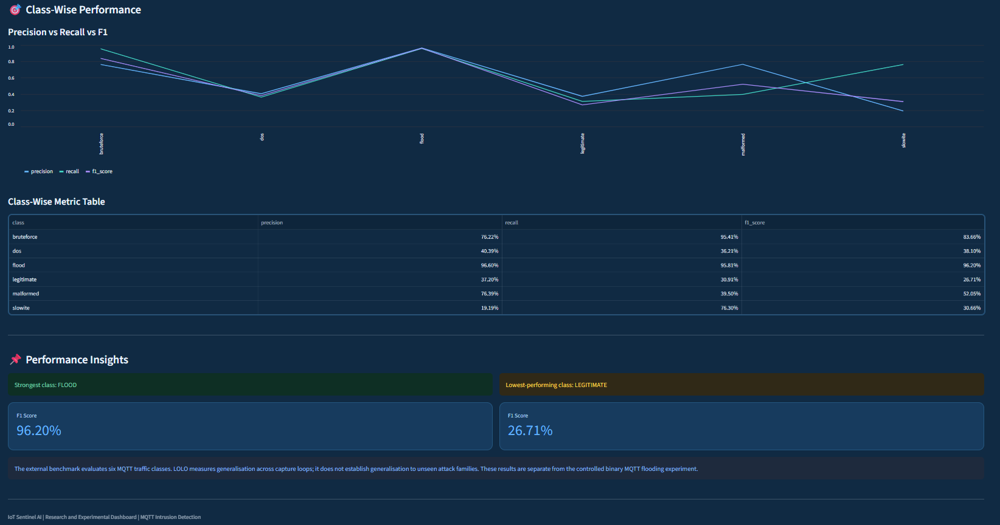

# IoT Sentinel AI
### Machine Learning-Based Intrusion Detection for MQTT-Based IoT Networks

IoT Sentinel AI is a machine learning-based security research project focused on detecting suspicious network activity in MQTT-based Internet of Things (IoT) environments.

The project combines a controlled MQTT testbed with an external MQTT intrusion-detection benchmark to investigate machine learning approaches for network traffic classification and intrusion detection.

It includes an experimental data collection pipeline, PCAP-based feature extraction, machine learning evaluation, an offline inference engine, and an interactive Streamlit dashboard.

---

## Research Question

How effectively can machine learning models identify malicious MQTT traffic using network traffic characteristics, and how do their detection capabilities perform across controlled experiments and an external MQTT benchmark?

## Project Objectives

- Develop a controlled MQTT-based IoT testbed for collecting network traffic.
- Extract network-level features from MQTT packet captures.
- Investigate machine learning approaches for binary intrusion detection.
- Evaluate detection performance under different MQTT message flooding rates.
- Assess multiclass classification performance using the external MQTTEEB-D dataset.
- Develop an offline inference engine for classifying MQTT traffic windows.
- Provide an interactive dashboard for traffic analysis, intrusion detection, and model evaluation.

---

## System Architecture

The project follows an experimental workflow consisting of data collection, feature extraction, model development, evaluation, and offline inference.

```text
Simulated IoT Devices
        |
        v
   MQTT Broker
   (Mosquitto)
        |
        v
 MQTT Traffic Collection
        |
        v
   PCAP Capture
        |
        v
  Feature Extraction
        |
        v
 Dataset Preparation
        |
        +----------------------------+
        |                            |
        v                            v
Controlled MQTT Testbed       MQTTEEB-D Dataset
        |                            |
        v                            v
Binary Classification        Six-Class Classification
        |                            |
        v                            v
Model Evaluation              External Benchmark
        |                            |
        +-------------+--------------+
                      |
                      v
              Offline Inference
                      |
                      v
              Streamlit Dashboard
```

The controlled testbed and external benchmark are evaluated separately because they use different datasets, feature sets, and classification tasks.

---

## Experimental Setup

A local MQTT environment was developed using Mosquitto and simulated IoT devices.

**Environment and tools:**

- MQTT Broker: Mosquitto 2.1.2
- MQTT Client Library: Paho MQTT 2.2.0
- Packet Analysis: Wireshark / TShark
- Programming Language: Python 3.13
- Operating System: Windows 11

Three simulated IoT devices publish sensor telemetry containing:

- Temperature
- Humidity
- Battery level
- Device status

A controlled MQTT message-flooding scenario was conducted at three configured message rates:

- 2 messages per second
- 5 messages per second
- 10 messages per second

The experiment produced:

| Experimental Metric | Value |
|---|---:|
| Independent runs | 9 |
| Telemetry records | 2,385 |
| PCAP-derived windows | 126 |
| Primary evaluation windows | 114 |
| Attack-free windows | 102 |
| Attack-present windows | 12 |
| Mixed boundary windows excluded | 12 |

The 12 mixed boundary windows were excluded from the primary binary evaluation to maintain clearer window-level labels.

---

## Machine Learning Methodology

### 1. Controlled Testbed: Binary Classification

The controlled experiment investigates binary classification of MQTT traffic into:

- `attack_free`
- `attack_present`

The final inference model uses four inter-arrival time features:

- Mean inter-arrival time
- Standard deviation of inter-arrival time
- Minimum inter-arrival time
- Maximum inter-arrival time

A Random Forest classifier was selected for the final offline inference engine.

Model evaluation used **3-fold StratifiedGroupKFold**, with grouping by independent experiment run (`run_id`) to reduce the risk of data leakage between training and validation folds.

### 2. Binary Model Evaluation

The following models were evaluated:

| Model | Accuracy | Balanced Accuracy | Precision | Recall | F1 Score |
|---|---:|---:|---:|---:|---:|
| Dummy Baseline | 89.47% | 50.00% | 0.00% | 0.00% | 0.00% |
| Random Forest (Network) | 100.00% | 100.00% | 100.00% | 100.00% | 100.00% |
| Random Forest (Combined) | 100.00% | 100.00% | 100.00% | 100.00% | 100.00% |
| Isolation Forest (Network) | 61.40% | 78.43% | 21.43% | 100.00% | 35.29% |

The two Random Forest models achieved perfect scores on the primary grouped cross-validation evaluation.

**Important:** The primary evaluation contains only 12 attack-present windows. Therefore, the perfect scores should be interpreted in the context of this limited controlled dataset and should not be considered proof of generalization to all MQTT attacks or real-world IoT networks.

### 3. Held-Out Flooding-Rate Evaluation

Additional evaluation was performed by holding out individual flooding rates from model training.

| Held-Out Rate | Training Rates | Test Windows | Accuracy |
|---|---|---:|---:|
| 2 msg/s | 5, 10 msg/s | 8 | 100% |
| 5 msg/s | 2, 10 msg/s | 8 | 100% |
| 10 msg/s | 2, 5 msg/s | 8 | 100% |

These results demonstrate performance across the tested flooding rates within the same message-flooding attack family. They do not establish generalization to previously unseen attack families.

---

## External Benchmark: MQTTEEB-D

The project also evaluates a separate six-class MQTT intrusion-detection task using the external **MQTTEEB-D** dataset.

### Dataset Summary

| Metric | Value |
|---|---:|
| Original records | 222,813 |
| Records with missing labels excluded | 246 |
| Usable records | 222,567 |
| Number of classes | 6 |

The six evaluated classes are:

- Legitimate
- DoS
- Flood
- Brute Force
- Malformed
- SlowITe

### Evaluation Methodology

The external benchmark uses **4-fold Leave-One-Loop-Out (LOLO) validation**.

For each fold, three capture loops are used for training, while the remaining capture loop is held out for testing.

This evaluation measures performance across different capture loops. It does not establish generalization to unseen attack families.

### Overall Benchmark Results

| Metric | Score |
|---|---:|
| Mean Accuracy | 49.97% |
| Balanced Accuracy | 62.36% |
| Macro Precision | 57.66% |
| Macro Recall | 62.36% |
| Macro F1 Score | 54.56% |
| Weighted F1 Score | 51.47% |

### Class-Wise Performance

| Class | Precision | Recall | F1 Score |
|---|---:|---:|---:|
| Brute Force | 76.22% | 95.41% | 83.66% |
| DoS | 40.39% | 36.21% | 38.10% |
| Flood | 96.60% | 95.81% | 96.20% |
| Legitimate | 37.20% | 30.91% | 26.71% |
| Malformed | 76.39% | 39.50% | 52.05% |
| SlowITe | 19.19% | 76.30% | 30.66% |

The model achieved its strongest F1 score for the Flood class, while Legitimate traffic was the weakest-performing class.

These results highlight the challenges of multiclass MQTT traffic classification across different capture loops.

---

## Offline Inference Engine

IoT Sentinel AI includes an offline inference engine implemented in Python.

The inference engine:

- Loads the trained Random Forest model.
- Validates the required input features.
- Accepts traffic-window feature data.
- Predicts whether a window is attack-free or attack-present.
- Calculates class probabilities.
- Reports prediction execution time.
- Supports CSV-based batch inference.

The final inference model uses four inter-arrival time features.

### Inference Benchmark

The inference benchmark was conducted using 1,000 sequential single-row prediction calls after 100 warm-up calls.

| Metric | Result |
|---|---:|
| Mean Latency | 76.772 ms |
| Median Latency | 76.488 ms |
| Minimum Latency | 73.9455 ms |
| Maximum Latency | 111.3691 ms |
| 95th Percentile | 79.398 ms |
| 99th Percentile | 81.304 ms |
| Throughput | 13.025 predictions/second |

The benchmark measures the prediction call, including model prediction and probability calculation, after feature validation. Model loading and warm-up are excluded.

These measurements represent the tested Python inference environment, not end-to-end MQTT processing latency or embedded-device performance.

---

## Interactive Streamlit Dashboard

The project includes an interactive dashboard built using Streamlit.

The dashboard provides five main sections:

1. **System Overview:** Project summary, model information, experimental statistics, and CSV upload.
2. **Traffic Analysis:** MQTT experiment selection, packet-rate analysis, inter-arrival-time visualization, and traffic records.
3. **Intrusion Detection:** Offline CSV inference, prediction results, attack probabilities, and downloadable results.
4. **Model Evaluation:** Model comparison, F1 scores, confusion matrix counts, and held-out flooding-rate results.
5. **External Benchmark:** MQTTEEB-D overall performance, LOLO fold results, and class-wise evaluation.

### Dashboard Screenshots

#### 1. System Overview



#### 2. MQTT Traffic Analysis





#### 3. Intrusion Detection





#### 4. Model Evaluation



#### 5. MQTTEEB-D External Benchmark





---

## Technology Stack

| Category | Technologies |
|---|---|
| Programming Language | Python |
| Machine Learning | Scikit-learn |
| Data Processing | Pandas, NumPy |
| Visualization | Matplotlib, Streamlit |
| MQTT Communication | Mosquitto, Paho MQTT |
| Packet Analysis | Wireshark, TShark |
| Model Serialization | Joblib |
| Testing | Pytest |
| Development Environment | VS Code |
| Version Control | Git and GitHub |

---

## Repository Structure

```text
IoT-Sentinel-AI/
│
├── dashboard.py
├── requirements.txt
├── requirements-dev.txt
├── README.md
├── .gitignore
│
├── .streamlit/
│   └── config.toml
│
├── data/
│   ├── raw/
│   ├── processed/
│   └── external/
│
├── docs/
│   └── screenshots/
│       ├── 01_dashboard_overview.png
│       ├── 02_traffic_analysis_part1.png
│       ├── 03_traffic_analysis_part2.png
│       ├── 04_intrusion_detection_part1.png
│       ├── 05_intrusion_detection_part2.png
│       ├── 06_model_evaluation.png
│       ├── 07_external_benchmark_part1.png
│       └── 08_external_benchmark_part2.png
│
├── models/
│   ├── random_forest_interarrival_v2.joblib
│   ├── random_forest_network_v2.joblib
│   ├── random_forest_combined_v2.joblib
│   └── isolation_forest_network_v2.joblib
│
├── reports/
│   ├── model_evaluation_v2.csv
│   ├── model_evaluation_summary_v2.json
│   ├── inference_benchmark_v2.json
│   ├── primary_inference_v2.csv
│   ├── unseen_flood_rate_evaluation_v2.csv
│   ├── final_detector_manifest_v2.json
│   └── mqtteeb/
│       └── multiclass_v1/
│           ├── class_metrics.csv
│           ├── confusion_matrix.csv
│           ├── experiment_summary.json
│           └── fold_metrics.csv
│
├── scripts/
│   ├── audit_mqtt_experiment.py
│   ├── benchmark_inference_v2.py
│   ├── extract_pcap_features.py
│   ├── extract_pcap_features_v2.py
│   ├── prepare_ml_dataset_v2.py
│   ├── train_evaluate_models_v2.py
│   ├── train_final_detector_v2.py
│   ├── evaluate_unseen_flood_rates_v2.py
│   └── train_mqtteeb_multiclass_v1.py
│
└── tests/
    └── test_inference_engine_v2.py
```

---

## Installation and Usage

### 1. Clone the Repository

```bash
git clone https://github.com/khhadiya-09/IoT-Sentinel-AI.git
cd IoT-Sentinel-AI
```

### 2. Create a Virtual Environment

```bash
python -m venv .venv
```

Activate it on Windows PowerShell:

```powershell
.venv\Scripts\Activate.ps1
```

### 3. Install Dependencies

```bash
python -m pip install -r requirements.txt
```

For development and testing:

```bash
python -m pip install -r requirements-dev.txt
```

### 4. Run the Dashboard

```bash
streamlit run dashboard.py
```

The dashboard will open in your browser.

### 5. Run the Tests

```bash
python -m pytest tests/ -v
```

### Important Dataset and Model Notes

- Raw experimental PCAP files and datasets are not included in the repository.
- The external MQTTEEB-D dataset must be obtained separately and placed in the expected local data directory before reproducing its training workflow.
- The large trained MQTTEEB-D multiclass model artifact is excluded from GitHub.
- The dashboard's external benchmark page displays the saved evaluation reports and does not require that large model artifact.
- The final binary inference model is included in the repository.

---

## Project Limitations

- The controlled testbed evaluates MQTT message flooding as its attack scenario; it does not cover every possible MQTT attack.
- The primary binary evaluation contains only 12 attack-present windows, so its perfect scores require cautious interpretation.
- Held-out flooding-rate evaluation covers different rates within the same attack family, not unseen attack families.
- The external MQTTEEB-D benchmark shows moderate overall multiclass performance, with substantial differences between classes.
- Leave-One-Loop-Out evaluation measures generalization across capture loops, not across unseen attack families.
- The dashboard performs offline CSV inference. It does not provide live MQTT traffic monitoring or real-time network intrusion prevention.
- Inference benchmarks were measured in a desktop Python environment and do not establish performance on resource-constrained IoT devices.

---

## Future Work

- Expand the controlled testbed with additional MQTT attack scenarios.
- Collect more independent experimental runs and attack-present samples.
- Investigate improvements to legitimate-traffic classification in the external benchmark.
- Evaluate the models on additional independent MQTT environments.
- Explore real-time inference and deployment in resource-constrained IoT environments.
- Investigate explainable machine learning techniques for MQTT intrusion detection.

---

## Author

**Hadiya Khan**

- GitHub: [@khhadiya-09](https://github.com/khhadiya-09)
- Project: IoT Sentinel AI
- Domain: Computer Engineering Student | Cybersecurity and IoT Research

---

## Acknowledgements

This project was developed as an academic research project exploring machine learning-based intrusion detection for MQTT-based IoT networks.

If you find this project useful, feel free to explore the repository and its implementation.